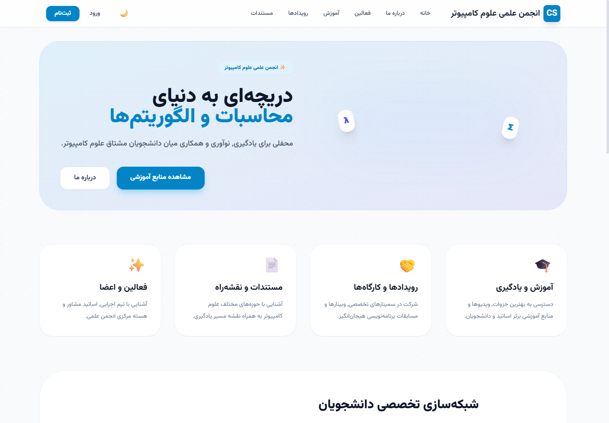

<div dir="rtl" align="right">

# پرتال انجمن علمی علوم کامپیوتر

یک نمونه‌کار Frontend فارسی و واکنش‌گرا برای مدیریت تجربهٔ دیجیتال یک انجمن علمی دانشگاهی؛ از انتشار منابع آموزشی و رویدادها تا شبکه‌سازی دانشجویان، پیام‌رسانی و پنل مدیریت.

[دموی زنده](https://reza-akbarzadeh.github.io/Scientific-Association-of-Computer-Science/) · [گزارش مشکل](https://github.com/reza-akbarzadeh/Scientific-Association-of-Computer-Science/issues)

</div>



<div dir="rtl" align="right">

## دربارهٔ پروژه

این پروژه یک Single Page Application برای انجمن علمی علوم کامپیوتر است که با تمرکز بر زبان فارسی، چیدمان RTL، تجربهٔ کاربری واکنش‌گرا و مدیریت چند نقش طراحی شده است. داده‌های نمونه و نشست کاربر در `localStorage` نگه‌داری می‌شوند تا همهٔ جریان‌های اصلی بدون نیاز به Backend قابل نمایش باشند.

این مخزن به‌عنوان نمونه‌کار، توانایی طراحی رابط محصول، مدل‌سازی جریان‌های کاربری، مدیریت State و ساخت یک اپلیکیشن چندبخشی با React و TypeScript را نمایش می‌دهد.

## قابلیت‌های اصلی

- صفحهٔ اصلی مدرن، واکنش‌گرا و سازگار با حالت روشن و تاریک
- معرفی اعضای شورای مرکزی، فعالان انجمن و پروفایل‌های تفصیلی
- مدیریت رویدادها، جزئیات رویداد، ثبت‌نام و گالری تصاویر
- کتابخانهٔ منابع آموزشی شامل درس‌ها، جزوه‌ها و ویدئوها
- بخش اسناد، نقشه‌راه‌ها و حوزه‌های تخصصی علوم کامپیوتر
- ثبت‌نام و ورود کاربران با گردش تأیید عضویت
- پروفایل کاربری و مرکز پیام‌ها
- شبکه‌سازی تخصصی دانشجویان بر اساس علایق و مهارت‌ها
- پنل مدیریت برای محتوا، کاربران، رویدادها و درخواست‌ها
- ذخیرهٔ پایدار داده‌های دمو در مرورگر

## فناوری‌ها

- React 19
- TypeScript
- Vite 6
- React Router 7
- Tailwind CSS (CDN در نسخهٔ فعلی نمونه‌کار)
- Browser Local Storage

## اجرای محلی

پیش‌نیاز: Node.js 20 یا جدیدتر و npm

```bash
git clone https://github.com/reza-akbarzadeh/Scientific-Association-of-Computer-Science.git
cd Scientific-Association-of-Computer-Science
npm install
npm run dev
```

سپس آدرس `http://localhost:3000` را باز کنید.

برای بررسی نسخهٔ Production:

```bash
npm run build
npm run preview
```

## حساب نمایشی مدیریت

برای مشاهدهٔ جریان پنل مدیریت می‌توانید از اطلاعات نمایشی زیر استفاده کنید:

- نام کاربری: `123`
- رمز عبور: `123`

این اطلاعات صرفاً بخشی از نمونهٔ Frontend هستند و احراز هویت واقعی محسوب نمی‌شوند.

## معماری و محدودیت‌های نسخهٔ فعلی

این نسخه یک Prototype سمت کاربر است. احراز هویت، مجوزها و داده‌ها در مرورگر شبیه‌سازی می‌شوند و برای استفادهٔ واقعی یا ذخیرهٔ اطلاعات شخصی مناسب نیستند. پیش از استفاده در محیط Production باید Backend امن، پایگاه داده، کنترل دسترسی سمت سرور، اعتبارسنجی ورودی و سیاست حریم خصوصی اضافه شود. جزئیات بیشتر در [SECURITY.md](SECURITY.md) آمده است.

## استقرار

Workflow موجود در `.github/workflows/deploy-pages.yml` پس از هر Push روی شاخهٔ `main` پروژه را Build و در GitHub Pages منتشر می‌کند. در تنظیمات مخزن، منبع Pages باید روی **GitHub Actions** قرار بگیرد.

## نکات برجسته برای رزومه

- طراحی یک محصول چندنقشی برای کاربران، اعضای انجمن و مدیران
- پیاده‌سازی رابط کاملاً فارسی با پشتیبانی RTL و Responsive Design
- ساخت جریان‌های کامل ثبت‌نام، تأیید، رویداد، محتوا، پیام و شبکه‌سازی
- مدیریت State و Persistence بدون وابستگی به Backend برای ارائهٔ دموی مستقل
- آماده‌سازی Build و CI/CD برای انتشار خودکار در GitHub Pages

</div>

---

## English summary

A responsive, RTL-first university Computer Science Association portal built
with React, TypeScript, and Vite. The portfolio prototype demonstrates
multi-role product flows for educational resources, events, student networking,
messaging, profiles, and content administration. Demo state is persisted in the
browser; production authentication and a backend are intentionally out of scope.

**Author:** [Reza Akbarzadeh](https://github.com/reza-akbarzadeh)
